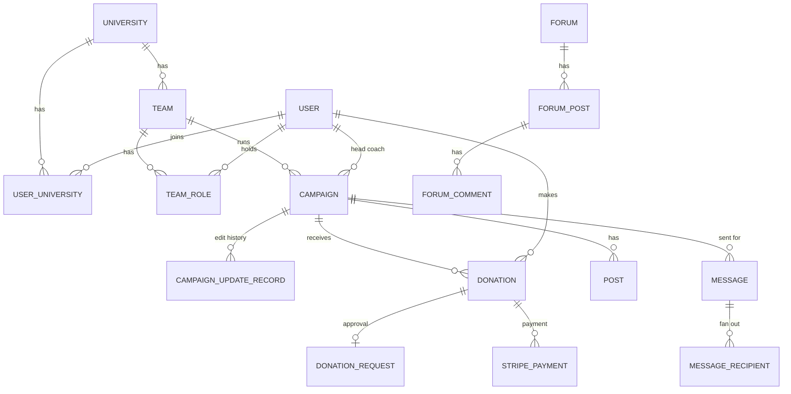

# Playbook: from Figma + scope of work to an ERD and a team plan

Written for you, plus copy-paste templates you can bring to the team. Simple English, Express comparisons where useful.

**Goal:** when a new SaaS product lands (a Figma file and a scope doc), you can go from "blank page" to "ERD draft, decision list, and a delivery plan" in a few days, without freezing on the big choices.

**Honesty notes.** The process is my recommendation from general practice, not something I tested. The one real example is **AKU-app** (`/Users/hasnain/projects/AKU-app`, read-only, nothing run, nothing changed). Observations about AKU show what the **code** does. I do not know the **intent**, so those become questions for the team, not verdicts. The Mermaid diagram in section 5 was written by hand from the foreign keys and **not rendered or checked**. Time boxes are my guesses.

---

## 1. The idea that removes hesitation

You do not need a perfect ERD. You need **decisions made on purpose**, written down, with the expensive ones made early and the cheap ones left alone.

**Sort every decision by how hard it is to undo:**

| Hard to undo (decide early, with the team) | Cheap to undo (decide alone, move on) |
|---|---|
| **Tenancy model**: one database for all customers with an org id on every table, or separate schemas/databases | Column names, most `string` lengths |
| **Who is a user**: one account can belong to many organizations, or exactly one | Adding a nullable column |
| **Primary key type**: bigint, UUID, or both (internal id plus public id) | Adding an index (use `CONCURRENTLY`) |
| **Money**: how amounts and currency are stored | Wording, labels, enum display text |
| **Roles and permissions model**: global role, per-organization role, per-resource role | Adding a new report query |
| **Deletion and retention**: hard delete, soft delete, legal retention, audit | Background job vs inline, early on |
| **Compliance scope**: PHI, PII, payments (this changes everything below) | Gem choice for small helpers |
| **Entity boundaries**: is "booking" one thing or three (request, approval, payment)? | Page size defaults |
| **API style and versioning**: GraphQL contract, how fields are deprecated | |
| **Where time lives**: time zones, `timestamptz`, business dates vs moments | |

Rule I suggest you follow: **spend your thinking time on the left column**, take a reasonable default on the right column, and write both down.

**The 70% rule:** when you have about 70% of the information and the decision is reversible, decide. When it is on the left column and you are under 70%, **ask a question**, do not guess (section 3 gives the question list).

---

## 2. Phase 0: read the inputs (half a day)

### 2.1 From the scope doc, extract five lists
1. **Actors**: who uses it (roles, including "system" and "admin of the platform").
2. **Nouns**: things that are stored. These become tables.
3. **Verbs and states**: what changes ("submit", "approve", "cancel"). These become status columns, transition rules, or history tables.
4. **Rules**: any sentence with *must, only, never, unless, at most, per*. These become constraints, validations, and policies. Highlight them, they are the most valuable lines in the doc.
5. **Numbers and promises**: users, rows per month, response times, retention periods, SLAs. These decide indexes, pagination, caching, and queues.

Also list: integrations (payments, SMS, email, calendar), notifications, file uploads, exports and reports, search, import, languages, and compliance words (HIPAA, GDPR, PCI, SOC 2).

### 2.2 From Figma, make a screen-to-data table
Walk every screen and fill one row per screen:

| Screen | Data shown (fields) | List? filters, sort, search, counts | Actions (buttons) | Who sees it | States (empty, error, loading) |
|---|---|---|---|---|---|
| Campaign list | title, goal, raised, status | filter by status, search by title, sort by date, "raised" is a **total** | create, archive | head coach, admin | empty state |

Why this table is powerful:
- **Fields** become columns. **"Raised amount"** shown as a total tells you it is an **aggregate** (computed or stored counter, a design decision).
- **Filters, sort, search** tell you which **indexes** you will need.
- **Actions** become mutations. **Who sees it** becomes policies.
- **A field that appears on two screens with different values** (for example "goal" before and after approval) reveals a hidden concept like **versions or drafts**.
- A screen you cannot explain is a **question for the designer**.

The Figma server is connected in this environment, so when you have a real file link I can read the screens and fill this table with you. The Google Docs connector needs authorization first (it is listed as needing auth), or you can export the doc as text and paste it.

---

## 3. Phase 1: questions before modelling (the "don't guess" list)

Send this to the product owner or tech lead **before** you draw anything. For each question, write **your default** so people can just say "yes". An unanswered question with a stated default is not a blocker.

| # | Question | Why it matters (what it changes) |
|---|---|---|
| 1 | Can one person belong to **more than one** organization (clinic, university, company)? | user-to-organization is one-to-many or many-to-many |
| 2 | Are organizations **fully isolated**, or is there shared data between them? | tenancy model, queries, policies |
| 3 | How many organizations and users in year 1 and year 3? Largest table size? | tenancy, indexes, pagination, caching |
| 4 | What are the **roles**, and is a role **global** or **per organization** or **per team**? | role tables vs a role column vs STI |
| 5 | Which things have a **lifecycle** (draft, pending, approved, rejected, archived)? Who can move them? Can they go backwards? | status design, transition rules, history |
| 6 | Is there **money**? Currencies, taxes, fees, refunds, who gets paid? | money columns, payment tables, reconciliation |
| 7 | Which data is **sensitive** (PHI, PII, payment data)? Which law applies? | encryption, audit, logging, access rules, vendors |
| 8 | What must be **audited** ("who changed what")? How long must data be kept? Can users delete their data? | audit tables, soft delete, retention jobs |
| 9 | Which **integrations** are required (payments, SMS, email, calendar, identity provider)? Which are v1? | job design, webhooks, idempotency, failure handling |
| 10 | Which **notifications** exist (email, SMS, push, in-app), and are they preferences-based? | notification tables, queues |
| 11 | **Files**: what types, sizes, who can see them, virus scanning? | storage, authorization on downloads |
| 12 | **Search**: what do people search for and how fuzzy? | `ILIKE`, trigram, full-text, external search |
| 13 | **Reports and dashboards**: which numbers, how fresh? | aggregates, materialized views, counters |
| 14 | **Real time**: chat, live updates, presence? | subscriptions, infrastructure |
| 15 | **Time zones and languages**? | `timestamptz`, business dates, i18n |
| 16 | **Import and export** of data (CSV, API)? | batch jobs, validation, error tables |
| 17 | **Plans and limits** (free vs paid, usage billing)? | plan tables, usage metering |
| 18 | What is **not** in scope for v1? | prevents building too much |

Anything you cannot get answered in a day: write the default, mark it **ASSUMPTION** in the decision log, and move on.

---

## 4. Phase 2: draft the ERD (1 to 2 days)

### 4.1 Method (in this order)
1. **Entities.** Turn the nouns into a list. Merge duplicates, split things that are really two ("donation" vs "payment").
2. **Relationships with cardinality.** For each pair: one-to-one, one-to-many, many-to-many. Ask "can it be zero? can it be many? what happens when the parent is deleted?"
3. **Many-to-many** always becomes a **join table**, and give it its own columns if the link has attributes (role, joined_at, status). Put a **unique index** on the pair.
4. **State machines** for the 3 to 5 most important entities: list states, allowed transitions, who may trigger each.
5. **Constraints**, from the rules list: `NOT NULL`, `UNIQUE`, foreign keys with an explicit `ON DELETE`, `CHECK` for status values and ranges.
6. **Indexes**, from the screen-to-data table: every foreign key, every filter, every sort.
7. **Walk the screens one more time** and ask of each: "can this be answered with one query and an index?" If not, you are missing a table, an index, or a stored aggregate.
8. Draw it (Mermaid text is easy to review and diff in a pull request), then attach the **state machines** and the **decision log**.

### 4.2 Pattern lookup (need to common design)
| Need | Usual design | Watch out for |
|---|---|---|
| Link with attributes between two entities | join table with its own columns, unique on the pair | not a bare `has_and_belongs_to_many` |
| Status with a history ("who approved when") | `status` column plus a `status_changes` (or events) table | status alone loses the history |
| **Approval of edits** (changes wait for approval) | a **revision/draft table** holding proposed values | copying every field into `pending_*` columns on the main table gets messy fast (see AKU below) |
| Money | integer **cents** plus a currency column, or `numeric` with explicit scale, **never float** | decide once, use everywhere, store fees as separate columns |
| Multi-tenant | org id on every tenant table, enforce it in the **database** too (composite foreign keys) | the CareSync findings 4 and the plan's Track A |
| Per-organization role | role on the membership (join) table, not on the user | a user can be admin in one org and viewer in another |
| Soft delete | `discarded_at` timestamp plus partial indexes, not a boolean | retention rules may require real deletion |
| Audit | audit table or a versions gem, store the actor | PHI copied into audit rows needs the same protection |
| Settings | one row per organization, or a singleton row | a free-form JSON blob is hard to validate |
| Ordering ("drag to reorder") | a `position` column | gaps and concurrent edits |
| Polymorphic ("comment on anything") | polymorphic reference **or** separate join tables | polymorphic loses foreign keys |
| Counters ("raised so far") | computed query, **or** a stored counter kept in sync | stored counters drift unless updated in a transaction or reconciled |
| Notifications | a table of notifications plus a delivery log | idempotency, per-channel preferences |
| Files | Active Storage attachments | authorization when serving the file |
| Public ids | UUID (or an extra public UUID) | UUID v4 vs v7 index behavior (plan Track A) |

### 4.3 ERD review checklist (use on your own draft, then in the team review)
- [ ] Every table has a primary key and timestamps.
- [ ] Every tenant table has the org column, and cross-tenant links are blocked in the DB.
- [ ] Every foreign key has an explicit `ON DELETE` decision, and an index.
- [ ] Every business rule from the rules list is a constraint, or I wrote down why it is not.
- [ ] Every status column has a `CHECK` and a written state machine.
- [ ] Money, time, and ids follow the written decisions.
- [ ] Every screen passes the "one query and an index" test.
- [ ] Sensitive fields are marked, with encryption and audit decisions.
- [ ] Deletion and retention are decided for every table.
- [ ] A new teammate could understand the diagram without me.
- [ ] I tried to break it: a second tenant, a deleted user, 100 times the data, a duplicate webhook, two people editing at once.

---

## 5. A real example: AKU-app, read as an ERD review

AKU is an alumni platform: universities, teams, campaigns, donations, forums, messaging. Facts **[read]** from `db/schema.rb` and models: 35 tables, 33 with UUID keys, 54 foreign keys, 125 indexes, **0 CHECK constraints**, 359 commits, Rails 7.0 with the same boilerplate family as FunctionRX (Devise-JWT, interactors, GraphQL, Sidekiq).



(Hand-written from the foreign keys. Not rendered or verified.)

**What this schema teaches, framed as questions you would ask the team.** Each is a design decision visible in the code:

| # | Observation [read] | Decision it reveals | Question to ask / lesson |
|---|---|---|---|
| 1 | Tenancy chain is **University, Team, Campaign**. Users join universities through `user_universities` (many-to-many, unique on the pair). | A person can belong to several universities. Good, deliberate. | Is isolation between universities enforced everywhere? Without DB-level checks, a team could point at a campaign of another university. (Composite foreign keys.) |
| 2 | Roles live in **two places**: user subclasses (`Users::HeadCoach`, `Donor`, `AthleticDirector`, ... via STI) **and** `team_roles.role_type`. | Role is both global (type) and per team (membership). | Which one is the source of truth? Can a user be a head coach on one team and assistant on another? This is the "who is a user, what is a role" decision from section 1. |
| 3 | Campaign approval: the `campaigns` table has `pending_fundraising_goal`, `pending_start_date`, `pending_end_date`, `pending_changes_status`, `has_pending_changes` **and** a separate `campaign_update_records` table. | Two mechanisms for "an edit waiting for approval". | A revision table would hold proposed values in one place. What happens for a **new** editable field: does someone add another `pending_*` column? |
| 4 | Money is `decimal(10,2)` in dollars, with `platform_fee`, `platform_fee_inclusive`, `currency` as separate columns. | Money representation decided at the start. | Is 10 digits enough? Are refunds modelled? Is fee-inclusive a per-donation setting or a platform rule? |
| 5 | A donation is **three tables**: `donations`, `donation_requests` (approval), `stripe_payments`. | Intent, approval, and payment settlement are separate concepts. | Good separation. Is there a state machine across the three, and what keeps them consistent if a webhook arrives twice? |
| 6 | `status` columns (campaign, donation, request) are free strings with defaults and **no `CHECK`**. | Status values are enforced only in Ruby. | One typo in code writes an impossible state. Add `CHECK` constraints. |
| 7 | Messaging is `messages`, `message_recipients` (one row per recipient), `message_logs`, `message_templates`. | Fan-out at send time. | Good for delivery tracking. How big can one fan-out be? Is it a background job? |
| 8 | `forum_post_views` and `post_reads` track who viewed or read what. | Read tracking as rows. | Rows per (user, post) grow fast. Is a counter or "last read marker" enough? |
| 9 | `global_app_settings`: one table, a `variant` integer and a `jsonb` blob. | A singleton settings table. | Which settings, who changes them, are they validated? |
| 10 | `archived` booleans on universities, teams, campaigns. | Soft state with a flag, not a timestamp. | When was it archived and by whom? Does archiving cascade to children? |

You can run exactly this review on any schema in 30 minutes, and it is the muscle this playbook trains.

---

## 6. Phase 3: the decision log (the document that lets you work without hesitation)

One page per decision, kept in the repo (`docs/decisions/`). It is short on purpose.

**Template (copy this):**
```
# D-007: How do we store money?
Status: proposed | accepted | superseded by D-0xx
Date: 2026-10-22      Owner: <name>      Decided with: <names>
Reversibility: hard | medium | easy

Context: (2 to 4 lines: what we need and why it is not obvious)
Options:
  A. integer cents + currency column.   Pros / Cons
  B. numeric(12,2).                     Pros / Cons
  C. a money gem.                       Pros / Cons
Decision: A, because ...
Consequences: (what this forces later, what we gave up)
Revisit when: (a trigger, e.g. "if we support currencies with 3 decimals")
```

**Start with these ten, in this order** (they match the "hard to undo" column): tenancy, user and membership model, primary keys, roles and permissions, money, deletion and retention, compliance and audit, API style and versioning, time and time zones, background jobs and integrations style.

**Who decides what (simple, no meetings about it):**
| Type of decision | Decided by | How |
|---|---|---|
| Hard to undo, affects everyone | tech lead or the team, with you proposing | written proposal, 24 hour async review, then decision |
| Hard to undo, product meaning (roles, states, money rules) | product owner, with you asking the questions in section 3 | answer or accept your default |
| Easy to undo | you | decide, note it, move on |

**If people disagree:** agree on the **reversibility** first. If it is cheap to undo, the owner decides today. If it is expensive, time-box one discussion (30 minutes), pick the safer option, write the "revisit when" trigger.

---

## 7. Phase 4: plan the delivery (1 day)

1. **Walking skeleton first.** Auth, tenancy, one entity, end to end, with tests, in production-like CI. That is what CareSync's first guides did. It proves the foundations before features pile up.
2. **Risk first.** List the 3 scariest unknowns (payments, real-time, a vendor integration, a data import). Do a **spike** (1 to 2 days, throwaway) on each in week 1. Surprises are cheap early.
3. **Vertical slices.** Each slice delivers one user-visible thing through all layers. Reuse your own checklist: [guide-adding-a-crud-resource.md](guide-adding-a-crud-resource.md) (type, queries, mutations, policy, tests) plus hardening from guide 09.
4. **Definition of done** (write it once, use it for every slice): tests green, policy and tenancy tests, no secrets in logs, rubocop and security scan clean, migration is safe, decision log updated.
5. **Estimates as ranges** with a confidence note ("3 to 5 days, medium, depends on the Stripe account"). Re-estimate after the first slice.
6. **Milestones tied to demos**, not to dates alone.

### Kickoff meeting (45 minutes)
1. 5 min: goal and what is out of scope.
2. 10 min: walk the screen-to-data table and the actors.
3. 15 min: the open questions from section 3 (only the unanswered ones).
4. 10 min: the draft ERD, the three riskiest decisions, and the spike plan.
5. 5 min: owners, review cadence, how decisions get made.

### Team agreements worth writing down
Migrations are reviewed by a second person and checked for table locks. Pull requests stay small. Schema changes and decisions are logged. One shared ERD file is the source of truth.

---

## 8. Where AI helps and where it must not decide

You said you already know how to do the work with AI. For this job, use it to be **faster at thinking**, not to **replace the decision**.

**Good uses:**
- Paste the scope doc and ask for the **five lists** (actors, nouns, verbs, rules, numbers), then check them against the doc yourself.
- Ask for the **question list** for your domain (section 3 is the base).
- Draft the Mermaid ERD, then ask the AI to **attack it**: "list ten ways this breaks with a second tenant, deleted users, duplicate webhooks, 100 times the data, concurrent edits."
- Ask for **alternatives** per decision with pros and cons, then you choose.
- Generate migrations and tests (you review every line, as you do now).

**Never delegate:**
- The **hard-to-undo** decisions (the product and the team own them).
- Whether something is **allowed with sensitive data**. **Check your company's rules before pasting a scope doc, Figma contents, or real data into any AI tool.** I do not know your policy.

**Habit that keeps you honest:** for every AI answer you use, you should be able to say why it is right for **this** product in your own words. If not, it is not decided yet.

---

## 9. Practice (so it becomes automatic)

Do these before the real project. About half a day each.

1. **Reverse-engineer a screen.** Take three screens of a product you know (FunctionRX or AKU). Fill the screen-to-data table, derive the tables, then compare with the real schema. Note every difference and ask "why".
2. **Run the review table (section 5) on FunctionRX.** I already listed its issues in [audit-functionrx-api.md](audit-functionrx-api.md). Cover the audit, write your own list from the schema, then compare.
3. **Write three decision log entries** for CareSync: UUID or bigint ids (finding 8), where the role lives (enum or membership table), and how to store money for the usage billing exercise. Argue both sides.
4. **Dry run on a small fake product.** I can write a one-page fake scope doc ("a clinic scheduling SaaS") with a few fake screen descriptions, and you produce questions, an ERD, a decision log, and a slice plan. Then I review it like a tech lead would.
5. **Break your own ERD** with the section 4.3 last checkbox.

**Done when:** from a scope doc and a few screens you can produce, in a day, a question list, an ERD with state machines, a ten-item decision log, and a slice plan, and explain each hard decision in two sentences.

## 10. Takeaway (write your own, 2 lines)
Write what you learned in your own words in your notes, as agreed.
