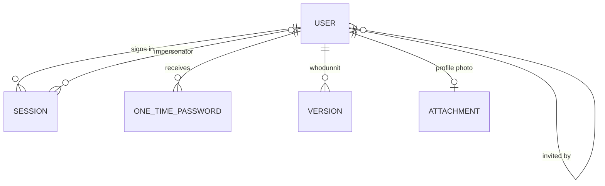

# SaaS template API: the contract from the frontend, and how we start

Written for you. It replaces D-000 of [saas-template-plan.md](saas-template-plan.md): **decided, we build our own separate backend from scratch, we do not touch `saas-api`, and `saas-setup` (the frontend) is the specification.** Simple English, Express comparisons where useful.

## 0. Honesty notes

- **Read-only, nothing run.** I read in `saas-setup`: every file in `app/graphql/` (all operations and fragments), the Apollo client files (`links.ts`, `errorLink.ts`), the auth feature (login, OTP, signup hooks, `nextStep.ts`, types, impersonation and session utils), the constants of co-admins, email logs, feature flags, settings, `.env.example` and `.env.e2e.example` (examples only, I opened **no** real `.env`), the routes, the first part of `QA-feature-flags.md`, and the e2e folder listing.
- **Not read:** the rest of `errorLink.ts` (after the access-revoked branch), the dashboard components, settings and co-admins component code, the e2e specs and fixtures, resources/SMS/clinic feature code. Where the contract depends on those, I say so.
- **Section 3 comes from the frontend only.** The frontend's own comments say it was written against `saas-api`, which is why the contracts match. **Sections 4 and 5 were first written after I had read `saas-api`, and they were influenced by it. You asked for our own style, so they were rewritten from first principles (requirement, options, criteria, recommendation).** I will not read `saas-api` again unless you ask. Challenge anything that looks too familiar.
- The ERD in section 5 is a derivation **after an exercise you should try first**. The Mermaid is hand-written, not rendered.
- Design recommendations are mine, with stated criteria. Numbers (lifetimes, limits) are starting suggestions to decide. Time guesses are mine.

---

## 1. What "the frontend is the spec" means (and its trade-offs)

**Contract-first.** The frontend already says exactly which operations exist, what they accept, and what they return. If our API matches that, **the real UI runs against it unchanged**. That gives you the best feedback loop there is: after each guide you open the screen and see it work.

Things to know:
1. **Our contract will look the same from outside as `saas-api`'s**, because the frontend dictates the shapes (`input: { registerAttributes: {...} }`, `allData`, `nextPage`, ...). That is expected. **The contract is not the design.** Your design is in the data model, security details, tests, and in what you add (organizations, billing). Be open with your lead that the frontend sets the surface.
2. **The contract also constrains design.** Example: the frontend treats an invitation as a **pending user** (`allUsers(pending: true)`, `resendInvitation(id)` returns a user). That pushes the data model toward "invited = user row" in phase 1, even though a separate `invitations` table is cleaner once organizations exist. Noticing this tension is exactly the kind of decision the playbook is about.
3. **Duplicated constants.** The frontend copies server rules (`OTP_RESEND_COOLDOWN_SECONDS = 30`, `MAX_INVITE_EMAILS = 20`). If our API picks other values, we change the frontend constant too. Keep a list of such coupled values.
4. **Where the frontend is wrong or full of leftovers, we may change the frontend.** You own a lot of it (239 commits). Contract changes should be deliberate and logged.

---

## 2. Scope: what is template, what is leftover

The frontend is a mix. Its own code says `// saas-api has no onboarding step`, and its role list still has `team_member`, `clinic_admin`, `practitioner`, `client` (from the clinic product, `FunctionRX`). Proposed split:

| Frontend piece | Evidence | Proposal |
|---|---|---|
| Sign up, login, OTP, resend, forgot and set password, logout | auth routes and mutations | **Core, phase 1** |
| Invitations (create, resend, delete, validate token, accept) | `coAdminMutations`, `ACCEPT_INVITATION` | **Core, phase 1** |
| Users admin page (tabs: active, pending, archived; search; archive; revoke access; edit name and photo) | `co-admins` feature | **Core, phase 1** |
| Settings (name, photo, password, email change with code) | `settings` feature | **Core, phase 1** |
| Feature flags (public and per user) | `featureFlagQueries`, `feature-flags` | **Core, phase 1** |
| Impersonation | `IMPERSONATE_USER`, `impersonation.ts` | **Core, phase 1** |
| Email logs (list, detail) | `emailLogQueries` | **Core, phase 1** |
| Dashboard (admin vs personal view) | `DashboardPage.tsx` | **Phase 1, data source not checked.** Find out what numbers it shows |
| `crud` demo page | route `crud`, e2e `CrudDemoPage` | **Candidate for the canonical example.** Open it and see |
| Clinic operations (`clinicOnboarding`, `updateClinic`, `fetchClinic`) | `clinicMutations`, `clinicQueries` | **Leftover.** Replace later by **organization** (phase 2) or delete |
| Subscription checkout, `pricing`, `payment-success`, `payment-failed` | `subscriptionMutations` | **Phase 3** (billing) or delete |
| Resources CRUD (title, category, type, video link, PDF) | `resources*` | **Leftover or example.** Decide if it becomes the "copy me" entity |
| SMS logs | `smsLogQueries` | **Later** (mirror of email log) or delete |
| Onboarding steps `sign-document`, `add-calendar`, `profile-setup` | onboarding routes, `nextStep.ts` | **Leftover** (clinic roles only) |
| Legacy roles (`team_member`, `clinic_admin`, `practitioner`, `client`) | `types.ts`, `legacyRoles.ts` e2e fixture | **Drop** from the template (frontend cleanup) |

**Phase 1 = the "Core" rows.** That is roughly 27 operations, listed next.

---

## 3. The contract (phase 1 core), derived from the frontend

### 3.1 Cross-cutting rules the frontend relies on

| Rule | Where I saw it | What the API must do |
|---|---|---|
| Endpoint: `POST {API_URL}/graphql`, Apollo via `UploadHttpLink` | `links.ts` | GraphQL over HTTP **plus multipart file uploads** (`Upload` scalar). On Rails that needs the `apollo_upload_server` gem |
| Header `Authorization: Bearer <token>` | `links.ts` | Token is **opaque to the frontend** (any string). We choose JWT or a random session token |
| Auth failure: `extensions.code` is `UNAUTHENTICATED` or `UNAUTHORIZED` (or HTTP 401) | `errorLink.ts` | Frontend ends the session and logs out |
| Revoked access: `extensions.code` is `ACCESS_REVOKED` | `errorLink.ts` | Frontend logs out with no toast |
| HTTP 413 and 429 get friendly messages | `errorLink.ts` | Our rate limiting should answer **HTTP 429**. Big bodies 413 |
| **Pre-auth operations** (a 401 here does not log out): `RegisterUser`, `LoginUser`, `ValidateOtp`, `ResendOtp`, `SendResetPasswordInstructions`, `SetPassword`, `AcceptInvitation` | `errorLink.ts` | These **operation names** are part of the contract. Do not rename them in the frontend without updating this list |
| The frontend maps two legacy messages to friendly text ("invalid credentials", "unable to find user associated with email") | `errorLink.ts` | We use **codes**, not message matching. Also a **security point**: the second message reveals which emails exist. Our API must **not** say that (guide 08 rule) |
| Mutations use Relay-classic shape: `mutationName(input: {...}) { ... }`, `clientMutationId` accepted | `authMutations.ts` (`logout` sends it) | graphql-ruby `RelayClassicMutation` |
| Lists return `{ count, nextPage, prevPage, totalPages, allData[] }` with `page` and `perPage` arguments | `allUsers`, `allEmailLogs`, `connectionFields` | **Offset pagination is part of the contract** (keyset cannot give page numbers). New lists can still use cursors later |
| Aliases: `userType: role`, `revokeAccess: accessRevoked` | `fragments.ts` | Field names on the API are `role` and `accessRevoked` |
| IDs are `ID` strings | all | bigint or UUID both work (D-004) |
| `message` fields are shown to users in toasts (`resendOtp.message` etc.) | `useOtpMutation.ts` | Messages must be safe for end users |
| Unexpected GraphQL errors are toasted from the API's `message` by the error link | `errorLink.ts` (rest not read) | **Never put internal text in error messages** (the FunctionRX audit finding 6) |

### 3.2 Mutations

| Operation (name matters) | Input | Returns | Behavior the frontend expects |
|---|---|---|---|
| `registerUser` | `registerAttributes { email password passwordConfirmation firstName lastName }` | `message token user` | If **OTP is off** for this user: `token` and `user` (signed in at once). If **on**: only `message`, a code was emailed, the UI goes to `/otp`. Gated by `signUpEnabled` |
| `loginUser` | `loginAttributes { email password }` | `message token user` | Same pattern as register |
| `validateOtp` | `otpCode email purpose` (`SignInPurposeEnum`: `login` or `password_reset`) | `token resetPasswordToken user` | `login`: returns `token` and `user`. `password_reset`: returns `resetPasswordToken` and **no session** |
| `resendOtp` | `email purpose` | `message` | Cooldown (frontend assumes **30 s**) |
| `sendResetPasswordInstructions` | `email` | `message` | **Always succeeds** (no account enumeration). Sends an OTP with purpose `password_reset` |
| `setPassword` | `setPasswordAttributes { password passwordConfirmation resetPasswordToken }` | `token user` | Signs the user in |
| `acceptInvitation` | `setPasswordAttributes { password passwordConfirmation token }` | `token user` | Token comes from the invitation link (`/setup-account?token=...`) |
| `requestEmailChange` | `email currentPassword` | `message user` | Code goes to the **new** address. `user.unconfirmedEmail` holds it |
| `resendEmailChangeCode` | `{}` | `message` | |
| `confirmEmailChange` | `otpCode` | `user` | Applies the new email. If the flag is off, the change is immediate (frontend flag `emailChangeOtpEnabled`) |
| `logout` | `clientMutationId` | `message success` | Ends the session |
| `impersonateUser` | `userId` | `token user` | Returns a token for the target user. The **frontend** keeps the admin's own token to go back |
| `updateUser` | `id?` and `userAttributes { firstName lastName image }` (`image: null` removes it) | `user` | No `id` means self. With `id`, an admin edits another user |
| `updatePassword` | `password currentPassword passwordConfirmation` | `success` | |
| `createInvitation` | `emails: [String!]!` (frontend caps at **20**) and `role: UserRoleEnum!` | `message users { email }` | Creates pending users and emails links. Gated by `invitationsEnabled` |
| `resendInvitation` | `id` | `user` | |
| `deleteInvitation` | `id` | `message` | |
| `archiveUser` | `id archived: Boolean!` | `user { id }` | Archive and unarchive |
| `updateUserAccess` | `id accessRevoked: Boolean!` | `user` | Revoke and restore access |

### 3.3 Queries

| Operation | Arguments | Returns |
|---|---|---|
| `fetchUser` | `id?` (none means me) | `user` including `featureFlags { ... }` |
| `allUsers` | `filters { role search status pending archived page perPage }` | pagination of managed users. The UI sends `archived` and `pending` booleans for its three tabs. **`status` (`UserAccessStatusEnum`) is declared but the UI never sends it**, so its values are ours to define |
| `validateInvitationToken` | `token` | `valid error` |
| `fetchPublicFeatureFlags` | none (signed out) | `otpEnabled signUpEnabled` only |
| `fetchFeatureFlags` | `role?` (`user` or `super_admin`) | all five flags **as they apply to that role** |
| `allEmailLogs` | `filter { startDate endDate search status page perPage }` (`status`: `FAILED` or `SUCCESS`, upper case) | pagination of `{ createdAt errorMessage id mailer mailerMethod recipient sentAt status subject updatedAt }` |
| `fetchEmailLog` | `id` | the row above plus `attempts` and `body` |

### 3.4 Types and fields

**`User`** (as the frontend selects it): `id email firstName lastName fullName imageUrl role archived invitationPending invitationSentAt lastSignInAt accessRevoked unconfirmedEmail createdAt featureFlags { emailChangeOtpEnabled impersonationEnabled invitationsEnabled otpEnabled signUpEnabled }`.
`featureFlags` on a user describes **that user**: `invitationsEnabled` means "can people like this user be invited".

**Enums:** `UserRoleEnum` (`user`, `super_admin` for the template), `SignInPurposeEnum` (`login`, `password_reset`), `EmailLogStatus` (`FAILED`, `SUCCESS`), `UserAccessStatusEnum` (ours to define).

**The five flags** and their meaning (from the types and the QA guide I read): `sign_up_enabled`, `otp_enabled`, `email_change_otp_enabled`, `invitations_enabled`, `impersonation_enabled`. Each is on for everyone, for a role, or for one user. The API is the real gate, the UI only hides things. Sign-up, invitations and impersonation never apply to `super_admin`.

### 3.5 Questions the contract leaves open (decide and write them down)
1. Token format: random session token (revocable, idle timeout) or JWT? The contract allows either.
2. Does an unknown email on `loginUser` return the same error as a wrong password? (It must.)
3. What does `validateInvitationToken` return for expired, used, archived? (`valid` false with `error` text, what text?)
4. What happens to a user's sessions on password change, archive, revoke? (They should end.)
5. What is `status` in `allUsers` for? Delete it from the frontend query, or define it?
6. What does the dashboard need? (Not read yet.)

---

## 4. Design decisions, derived from first principles

**Why this section was rewritten.** The first version was written after I had read another company backend, and it showed. Here every choice starts from a **requirement** (usually from the contract in section 3), lists the **options**, judges them against stated **criteria**, and says **what would change my mind**. Where an answer happens to match something that already exists, it is because the reasoning led there, not because it was copied. I cannot fully un-see what I read, so **challenge anything that looks too familiar**.

**Criteria, in priority order** (same as [saas-backend-standards-and-claude-setup.md](saas-backend-standards-and-claude-setup.md) section 4): 1. security and privacy, 2. data integrity, 3. operability (debug, deploy, roll back), 4. simplicity (fewest moving parts), 5. team fit. The standards I would check these against (OWASP cheat sheets for authentication, sessions and forgot password, the Rails Security Guide, NIST SP 800-63B, PostgreSQL docs) are pointers from my own knowledge. **I did not open them in this session.**

Numbers (lifetimes, limits) below are **starting suggestions to decide**, not rules.

### 4.1 Sessions and tokens (D-A)
- **Requirements from the contract:** `logout` must end a session. Changing the password, archiving a user, and revoking access should end that user's sessions. `impersonateUser` returns a token that should be short lived. The frontend treats the token as an opaque string.
- **Options:** (1) stateless JWT only. (2) JWT plus a server-side allow or deny list. (3) an opaque random token plus a server-side session row.
- **Assessment:**
  - (1) cannot revoke before it expires. That fails the logout and revoke requirements unless expiry is very short plus a refresh flow, which adds complexity and a second token.
  - (2) still needs server state, so you carry the JWT risks (verification mistakes, algorithm confusion, key rotation) **and** a table. It only pays off if other services must verify tokens without calling this API. That is not a requirement.
  - (3) meets every requirement with the least moving parts. Cost: one indexed lookup per request, which can be cached later.
- **Recommendation:** (3). 256-bit random token. Store **only its SHA-256 digest** (a random token is already high entropy, so no slow hash is needed). Look up by digest. Absolute expiry plus an idle timeout (suggested: 7 days and 2 days). Impersonation is a session with an `impersonator_id` and a short life (suggested: 1 hour).
- **Would change my mind:** another service needs to verify tokens offline.

### 4.2 Password handling and the identity library (D-B)
- **Options:** Devise (with recoverable, lockable), or `has_secure_password` (bcrypt) plus our own services.
- **Assessment:** our flows (email-code login, reset through a code, invitations as pending users, impersonation) replace most of what Devise provides, and Devise's modules add columns and hidden behavior. Our own code is a small surface we fully understand, but it is **security-critical code we now maintain**, so it needs negative tests and a review checklist. Devise gives years of scrutiny for password storage, lockout, and recovery.
- **Recommendation:** own code on `has_secure_password`, **on the condition** that we add the `security-review-backend` skill, negative tests (forged token, replayed code, enumeration), and per-account throttling plus a timed lock (accepting that a lock lets an attacker annoy a victim, mitigated by IP throttling). A middle path is valid: Devise for password and recovery, our sessions table for tokens. **This is the lead's call.**
- **Would change my mind:** the team does not want to own authentication code.

### 4.3 One-time codes (D-C)
- **Requirement:** emailed 6-digit codes for login, password reset, and email change. The frontend assumes a resend cooldown of 30 seconds.
- **Design:** one row per (user, purpose), unique. Store an **HMAC** of the code (key from the app secret, never the code itself, because a 6-digit code has only 10^6 values and an unkeyed hash would be trivially reversible). Expire in 10 minutes or less. Count wrong attempts and lock the code after 5. Compare in constant time. A successful use deletes the row. Resend only after the cooldown. A new code for the same purpose replaces the old one, and **a login code can never replace a reset code** (the purpose is part of the key, and the frontend already sends it).
- **Email log risk (a real design problem in the contract):** the contract has an email log with the **body** visible to admins, and these emails contain live codes and links. **Options:** store full bodies (leaks live secrets to anyone who can read logs), store no body, or store a **redacted body** (mask codes and links for authentication mailers). **Recommendation:** redacted bodies for authentication mails, short retention with a purge job, admin-only access. The frontend's `body` field then shows the masked text. Needs the lead's agreement because it changes what the log page shows.

### 4.4 Reset and invitation tokens (D-D)
- **Requirement:** a link token that works once, expires, and dies if the state changes (a resent invitation invalidates the old link, a password change invalidates a reset token).
- **Options:** a random token with a stored digest column, or a **signed, expiring token whose validity depends on a fingerprint of current state** (Rails offers `generates_token_for` for this, from Rails 7.1, **which I have not run in this session**).
- **Recommendation:** the fingerprinted signed token. No extra table, single use by construction (the fingerprint changes when the token is used), expiry built in. For reset: fingerprint includes the password digest. For invitations: fingerprint includes the invite sent and accepted timestamps.
- **Would change my mind:** we need to list or revoke outstanding tokens individually.

### 4.5 Primary keys (D-E)
- **Options:** bigint, UUID, or bigint plus a separate public UUID.
- **Assessment:** enumeration risk is real but is handled by authorization and by returning the same `NOT_FOUND` for "not yours" and "does not exist". Bigint has better index locality. A separate public id means two ids per row and a lookup rule everywhere (more room for mistakes). All three company backends use UUIDs, so the team is familiar.
- **Recommendation:** **UUID primary keys**, one id everywhere. (My first version suggested bigint plus a public id. On re-derivation, simplicity wins.)
- **Would change my mind:** very large, write-heavy tables where index locality matters (then consider time-ordered ids).

### 4.6 Background jobs and Redis (D-F)
- **Options:** Sidekiq with Redis, Solid Queue (Postgres), GoodJob (Postgres).
- **Assessment:** Postgres-only has the fewest moving parts. Sidekiq has the team's experience, a mature dashboard, and fits where Redis already exists.
- **Recommendation:** Sidekiq with Redis, with one rule: **Redis is disposable** (queues, caches, rate-limit counters). **No system-of-record data lives only in Redis.** The Sidekiq dashboard, if mounted, is behind authentication.
- **Would change my mind:** the lead wants minimal infrastructure (then Solid Queue).

### 4.7 Feature flags (D-G)
- **Requirement:** five flags, each on for everyone, a role, or one user. An admin screen to flip them. Public read of two of them.
- **Options:** a library (Flipper) with a Redis store, the same library with a Postgres store, or our own tables.
- **Assessment:** flags are configuration that decides behavior, so they belong in a **backed-up, transactional store**. Redis is disposable by D-F. Writing our own gates (everyone, role, actor) plus an admin UI is more code than adopting a proven library.
- **Recommendation:** Flipper with the **ActiveRecord (Postgres) adapter** (I have **not verified** the adapter's current API), flag names defined in code and registered on deploy, the UI behind authentication, and a rule that sign-up, invitation, and impersonation flags never apply to the top admin role.
- **Would change my mind:** we need percentage rollouts at high volume (then reconsider the store).

### 4.8 Roles and enums (D-H)
- **Options:** integer enum, string enum with a `CHECK`, Postgres enum type.
- **Assessment:** integers are unreadable in SQL and cannot be reordered or reused safely. A string with a `CHECK` is readable, simple to extend, and enforced by the database.
- **Recommendation:** string plus `CHECK` for `role` (and every status). The contract's field name stays `role`. Organization roles go on a membership table when organizations exist.

### 4.9 Authorization (D-I)
- **Options:** policy objects (Pundit or similar), boolean permission columns, a role check in each resolver.
- **Assessment:** policy objects are explicit, testable as a matrix, and default-deny is easy to enforce. Permission **columns** need a migration and backfill for every new permission and are hard to audit. Per-resolver checks are easy to forget.
- **Recommendation:** policy objects, default deny, plus a permission-matrix test and a coverage test that fails when an operation has no permission test. Pundit is fine (you already know it).

### 4.10 Layering and folders (D-J)
See the layer diagram and the folder tree in [saas-backend-standards-and-claude-setup.md](saas-backend-standards-and-claude-setup.md) section 5. Decision pending: plain services with a Result versus the `interactor` gem.

### 4.11 The smaller decisions

| ID | Decision | Recommendation | Reason |
|---|---|---|---|
| D-K | Pagination | Offset (the contract needs page numbers). **One** pagination library only | Mixing libraries adds confusion. Cap `perPage`. Cursors for new lists. I have not compared pagy and kaminari here |
| D-L | Tests | RSpec, FactoryBot, WebMock. Request specs for GraphQL, negative security tests | Team standard. Test through the public face |
| D-M | Audit | Audit **chosen models**, not all. Skip sensitive columns, record the actor and request id | Auditing everything copies personal data into the audit table. Decide per model |
| D-N | Search | Generated text column plus a trigram index for users and email logs | `ILIKE '%x%'` cannot use a normal index |
| D-O | Email log | One row per delivery, unique delivery id (job retries update the row), redacted bodies, retention job, admin only | See 4.3 |
| D-P | Hardening | Depth and complexity limits, introspection off in production, throttling on anonymous operations returning HTTP 429, explicit CORS origin, log redaction (incl. the GraphQL query text) | You already learned these in guide 09 |
| D-Q | Error contract | Stable `extensions.code`. The frontend **requires** `UNAUTHENTICATED` (or `UNAUTHORIZED`) and `ACCESS_REVOKED` and HTTP 429. We add `FORBIDDEN`, `NOT_FOUND`, `VALIDATION_FAILED`, `INVALID_CREDENTIALS`, `INVALID_CODE`, `INVALID_TOKEN`, `RATE_LIMITED`, `INTERNAL_SERVER_ERROR` | Never return exception messages |
| D-R | Secrets and config | Rails credentials or environment variables. Never in code, Docker build arguments, or image `ENV` | Learned from the FunctionRX audit |
| D-S | Observability | An error tracker with data scrubbing, request ids, structured logs | Do not send GraphQL variables unscrubbed |

---

## 5. ERD: try it first, then read the derivation

### 5.1 Exercise (do this **before** reading 5.2) (about 1 to 2 hours)
From section 3 only, write down:
1. The **tables** you need and one sentence on why each exists. Hint: ask "what must be remembered between two requests?" for each operation.
2. For each table the **columns**, which are `NOT NULL`, which are unique, and which need a `CHECK`.
3. The **state machines** for: a user (invited, active, archived, access revoked), a one-time code, a session.
4. Which **indexes** the screens need (the users page filters by role, search text, archived, pending, and pages through results; email logs filter by status, dates, search).
5. What is **not** stored in plain text, and why (passwords, tokens, codes).
6. Where the contract **forces** a design choice you would not make freely (see section 1, point 2).

Write it in your notes, then compare. Differences are the learning.

### 5.2 Derivation: requirement to table (read after you tried)

Each row starts from something the product must do and derives the minimum structure. "Alternative" is what I considered and why I did not choose it.

| Requirement | Structure | Why | Alternative considered |
|---|---|---|---|
| Know who someone is | `users` (email, password digest, names, role) | identity must persist | none |
| Stay signed in between requests, end sessions on logout, revoke, password change | `sessions` (token digest unique, user, expiry, last activity, ip, user agent) | D-A: server-side state is what makes revocation possible | stateless JWT: cannot revoke |
| Sign in with an emailed code, reset with a code, confirm a new email | `one_time_passwords`, unique `(user, purpose)` | D-C | store the code on `users`: mixes concerns, cannot hold several purposes |
| Reset a forgotten password | no table, a signed token tied to the password digest | D-D | token table: more state to clean up |
| Invite someone before they have an account (contract: invitation = pending user) | columns on `users` for sent, accepted, invited by. Token as in D-D | the contract's `allUsers(pending: true)` and `resendInvitation(id)` treat an invite as a user | separate `invitations` table: cleaner once organizations exist, but the contract forces a union query today |
| Admin tabs: active, pending, archived. Revoke access | `archived_at`, `access_revoked_at` timestamps | a timestamp tells **when**, a boolean cannot | booleans |
| Change email with a code | `users.unconfirmed_email` plus a code of purpose `email_change` | keeps the old email valid until confirmed | a separate pending-change table |
| Profile photo | Active Storage attachment | type and size validated | a URL column |
| Impersonate a user for a short time | `sessions.impersonator_id` | the audit trail must show the real actor | a global admin flag on the session |
| Show sent emails to admins | `email_logs` (recipient, mailer, subject, redacted body, status, attempts, delivery id unique, sent at) | D-O, retries update the same row | log lines only: not searchable by admins |
| Know who changed what (our own requirement) | `versions` for **chosen** models | D-M | audit every model |
| Feature flags | the flag store tables (D-G) | backed-up store | Redis |
| Filter, search, and page the users and email lists | composite indexes on the filter columns plus a generated search column with a trigram index | D-N, and index must match the order and filter | `ILIKE` with no index |

### 5.3 Table notes (columns that matter, constraints)

**`users`**: `id` (uuid), `email` (**`citext`**, unique, `NOT NULL`), `password_digest` (**nullable**: an invited user has none until acceptance), `first_name`, `last_name`, `role` (string, **`CHECK` in the allowed roles**, `NOT NULL`, default the lowest role), `invitation_sent_at`, `invitation_accepted_at`, `invited_by_id` (self reference, `ON DELETE SET NULL`), `archived_at`, `access_revoked_at`, `unconfirmed_email`, `last_sign_in_at`, timestamps. A generated `search_document` plus a trigram index. Indexes for the admin list: `(role, created_at, id)` and `(created_at, id)`.
State rules to enforce in code and test: an archived or revoked user has no sessions; an invited user cannot sign in until acceptance; the last top-level admin cannot be archived or demoted.

**`sessions`**: `id`, `user_id` (`ON DELETE CASCADE`), `token_digest` (unique, `NOT NULL`), `expires_at`, `last_active_at`, `ip_address`, `user_agent` (truncated), `impersonator_id` (nullable FK to users). Index on `expires_at` for the purge job.
Open decision: delete a session row on logout (simplest) or keep it with `revoked_at` for history. I lean to deleting, and recording sign-ins in the audit trail if needed.

**`one_time_passwords`**: `user_id` (`ON DELETE CASCADE`), `purpose` (string, **`CHECK IN ('login','password_reset','email_change')`**), `code_digest` (HMAC), `failed_attempts`, `expires_at`. Unique `(user_id, purpose)`.

**`email_logs`**: as in the table above, plus a generated search column and a trigram index, index `(status, created_at, id)`. `status` is a string with a `CHECK`. A purge job deletes old rows.

**`versions`**: item, event, whodunnit (the acting user), changes. Decide per model what is excluded.

**Tenancy later:** adding `organizations` and `memberships` is additive (new tables, a nullable `organization_id` on `email_logs`, `versions`, `sessions`), plus moving invitation state from `users` to an `invitations` table. Whether to design that now or retrofit is decision **D-001** from the earlier plan, to settle with your lead **before the first migration**.

### 5.4 Diagram (hand-written, **not rendered or verified**)

### 5.5 Compare with what you wrote
- [ ] Did you store only digests of tokens, and an HMAC of codes?
- [ ] Is `(user, purpose)` unique on codes?
- [ ] Do archive and revoke end the user's sessions? (A rule, not a column. Where do you enforce it?)
- [ ] Is there a `CHECK` on every string status and role?
- [ ] Does the users list have the index it needs to filter and page?
- [ ] Did you notice the contract forces "invited user = user row"?
- [ ] Did you notice that email-log bodies would hold live codes, and decide what to do?
- [ ] Which of your choices differ from mine, and which of us has the better argument?

---

## 6. How we start (the order)

Same method as before: **try first, read the guide second, write a takeaway**. I write guides, review your diffs, and write tests only when you ask. **Acceptance for each guide: the matching screen in `saas-setup` works against your API.**

| Guide | Builds | Acceptance (frontend) |
|---|---|---|
| **T01** | Project setup and conventions: Rails API app, Postgres, RSpec, rubocop, brakeman, CI skeleton, GraphQL base (`RelayClassicMutation`, `Upload`), the **error contract** (`extensions.code`) and the 429 rule | GraphQL endpoint answers, error codes visible in the browser |
| **T02** | `users` and `sessions`, token issue and lookup, "auth required by default" | `fetchUser` with a token |
| **T03** | `registerUser`, `loginUser`, `logout`, flags `sign_up_enabled` and `otp_enabled` (Flipper) | `/signup`, `/login` |
| **T04** | OTP table, `validateOtp`, `resendOtp`, cooldown and attempts | `/otp` |
| **T05** | Password reset (`sendResetPasswordInstructions`, `setPassword`) with the no-enumeration rule | `/forgot-password`, `/reset-password` |
| **T06** | Invitations and the users admin (`createInvitation`, `acceptInvitation`, `allUsers`, archive, revoke, resend, delete) | `/co-admin` page, `/setup-account` |
| **T07** | Settings (`updateUser` with uploads, `updatePassword`, the email change flow) | `/settings` |
| **T08** | Email log (every email is a row, retries update it) | `/email-logs` |
| **T09** | Impersonation, audit (`versions`), hardening (limits, throttling, log redaction, CORS) | the impersonation banner, a clean log |
| **T10** | Template mechanics: `bin/setup`, rename script, docs, CI that runs the tests, a demo of starting a second project from it | the "new project in under an hour" test |

Phase 2 (after your lead decides): organizations, memberships, org invitations, per-org roles, canonical example CRUD (probably `crud` or `resources`). Phase 3: billing, notifications, SMS.

**Why this order:** each guide turns on one more screen, so you always have a working app and a visible check. The guides lean on what you already did in CareSync (08 password reset, 09 hardening, 07 policies), but the **implementation differs** (own sessions instead of Devise-JWT), which is the point of the exercise.

### Before T01, you need three answers
1. **Tenancy:** will the template have organizations (D-001)? If yes, do we design for it now or add it in phase 2? (My recommendation: ask your lead this week, build phase 1 either way.)
2. **Decisions D-A to D-S (section 4):** in particular D-A (own session tokens), D-B (own password code or Devise), D-F (Sidekiq + Redis) and D-L (RSpec), plus the layering choice in [saas-backend-standards-and-claude-setup.md](saas-backend-standards-and-claude-setup.md).
3. **Frontend scope:** may we delete the clinic leftovers (section 2) from `saas-setup`, or must the frontend stay as it is?

### Also useful
- **Acceptance tests already exist.** `saas-setup/e2e` is a Playwright suite (it expects a base URL, a co-admin login and an OTP). I did not read the specs, so I do not know whether they hit a real API or mock one. If real, they can check your API end to end. **Worth checking before T01.**
- The `crud` demo page may already be the canonical example screen. Open it and see what data it uses.
- Keep a **coupled values list** (OTP cooldown, max invite emails, flag names, operation names) in your docs.

## 7. Takeaway (write your own, 2 lines)
Write what you learned in your own words in your notes, as agreed.
