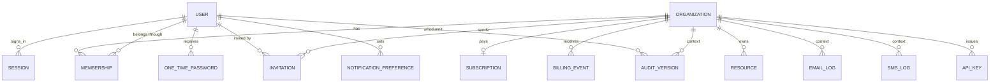

# SaaS template (Rails): where we start, what exists, ERD v0, and the plan

Written for you. Parts of it (the questions in section 6, the decision list in section 4, the ERD in section 5) are meant to be taken to your lead and team. Simple English, Express comparisons where useful.

## 0. Honesty notes

- **Read-only.** I read `saas-setup` (frontend: routes, GraphQL operations and fragments, team rules), and `saas-api` (README, Gemfile, `db/schema.rb`, core models, one policy, schema settings). I ran nothing, changed nothing, and did **not** open any `.env` file. `saas-backend` is an empty folder.
- **I did not read everything.** `saas-api` has about 2,000 lines of app code and 24 specs. I read the parts that decide the design. Anything I list as "missing" means **I did not find it in what I read**, not proof it does not exist.
- **Authorship counts** come from `git log`. I do not know who is assigned what, so I do not draw conclusions from names.
- **The ERD in section 5 is a draft with defaults, not a decision.** Several parts depend on answers only your lead can give (marked **D-xxx**). The Mermaid code was written by hand and **not rendered or checked**.
- Time boxes and effort guesses are mine.

---

## 1. What I found (this changes the question)

| Project | What it is | State |
|---|---|---|
| `saas-setup` | React Router + Apollo **frontend**. 278 commits, 2026-09-28 to 2026-10-21. | Active. Has an untracked `QA-feature-flags.md`. |
| `saas-api` | **Rails 8.1 GraphQL API** (Ruby 4.0.7, Postgres, Sidekiq 8 + Redis, Heroku). 25 commits, 2026-10-07 to 2026-10-20, README with setup and deploy docs, committed `schema.graphql`. | **Has uncommitted changes** in `app/graphql/concerns/graphql_operation.rb`, so someone is working in it right now. |
| `saas-backend` | empty folder | n/a |

Commit authors (from `git log`): the frontend has 239 commits under your name (plus a few others). `saas-api` has 18 commits from `shaistaabidd` and 7 from `wahab` / `AbdulWahab552`.

**So the template already has a front end and a back end under construction.** Your task as described ("create the template in Rails") may mean one of several things. I should not guess. This is **Question 0** (section 3).

### What `saas-api` already does (it is good, and worth learning from)
All **[read]**:
- **Auth:** email + password, **6-digit email codes (OTP)** for login and password reset (stored as HMAC, 10 minute life, 5 attempts, 30 second resend), email change with a code to the new address, logout.
- **Sessions:** own `sessions` table, random token (only its SHA-256 digest is stored), 7 day life, **2 day idle timeout**, IP and user agent, **impersonation** (`impersonator_id`, 1 hour). Changing the password or archiving a user kills sessions.
- **Invitations** (token with `generates_token_for`, 7 days) and **archive / revoke access** as timestamps (`archived_at`, `access_revoked_at`).
- **Feature flags** with **Flipper** (stored in Redis): sign-up, OTP, email-change OTP, invitations, impersonation. Flags can be on for everyone, a role, or one user, with a rule that some flags never apply to super admins. A public query exposes only the two flags a signed-out page needs.
- **Authorization:** `action_policy` (user and email-log policies), auth required by default.
- **Hardening:** `max_depth 12`, `max_complexity 300`, introspection off unless enabled by env or local, `rack-attack`, a `RateLimiter` service, CORS, `strong_migrations`, `bullet`, `brakeman`, `bundler-audit`, `rubocop-graphql`, Sentry.
- **Audit:** `paper_trail` on `User` (ignoring password digest and noisy columns).
- **Email log:** every email is a row (status, attempts, body), searchable with a generated column and a trigram index, 90 day purge task.
- **Search:** Postgres generated `search_document` column plus `pg_trgm` GIN index (the correct answer to the `ILIKE '%x%'` problem in the FunctionRX audit).
- **Tests and docs:** 24 spec files, README with deploy steps, schema dump committed.
- Notes the team left themselves: "there is no CI yet" (README), and a comment `# 2 belonged to the removed two-code email change; never reuse it` next to an **integer enum**. That comment is the cost of integer enums in real life (use strings plus a `CHECK` instead).

### What the frontend has that the API (in `saas-api`) does not provide
The frontend calls operations the `saas-api` schema does not have. They look inherited from the clinic product (FunctionRX):
- `clinicOnboarding`, `updateClinic`, `fetchClinic` (a **clinic** with address, theme, social links, many price fields)
- `createSubscriptionCheckout` plus pages `pricing`, `payment-success`, `payment-failed` (**Stripe billing**)
- **Resources** CRUD (title, category, type, video link, PDF)
- **SMS logs**, onboarding steps `sign-document` and `add-calendar`
- `co-admin` screens (which the API covers partly through invitations and `allUsers`)

Two ways to read this: the frontend still carries product leftovers that the template should drop or generalize, or these are planned template modules whose API does not exist yet. Another **question for the lead**.

---

## 2. What a "SaaS template" should contain (module inventory)

Status key: **API** = exists in `saas-api`, **FE** = screen exists in `saas-setup`, **GAP** = not found.

| Module | API | FE | Notes / what the template still needs |
|---|---|---|---|
| Sign up, login, logout | yes | yes | |
| OTP (email code) | yes | yes | TOTP app codes, backup codes: **GAP** |
| Password reset, change password | yes | yes | |
| Email change with confirmation | yes | yes | |
| Invitations | yes | yes | invitation is a **user row** (no organization or role-per-organization context) |
| Sessions and devices | table yes | no | list and revoke sessions: **GAP** (data exists, no operations) |
| Impersonation | yes | yes | |
| Feature flags | yes | yes | per-organization flags: depends on the tenancy decision |
| Roles and permissions | global `user` / `super_admin` | partial | **per-organization roles: GAP** |
| **Organizations / tenants / workspaces** | **GAP** | clinic only | the biggest hole for a "SaaS" (see D-001) |
| **Memberships** (user in organization with a role) | **GAP** | | |
| **Billing**: plans, subscriptions, invoices, webhooks | **GAP** | pricing and checkout pages | needs a decision on the provider and what is stored locally |
| Account settings | profile, password, email, avatar | yes | notification preferences, language, time zone, delete account, data export: **GAP** |
| Email log | yes | yes | |
| SMS log | **GAP** | yes | mirror of email log, only if SMS is in the template |
| Audit trail | paper_trail on users | no | viewer for admins, organization context on each version: **GAP** |
| File uploads | yes (avatar, S3) | yes | |
| Notifications (in-app, email, SMS preferences) | **GAP** | | |
| API keys, outgoing webhooks | **GAP** | | optional |
| Example tenant-owned CRUD (the thing to copy for a new entity) | **GAP** | `resources`, `crud` pages | the template needs **one canonical example** (the "resource" can become it) |
| Admin console | users, email logs | yes | organizations admin: **GAP** |
| CI/CD | **GAP** | `.github` exists | README says no CI yet |
| Deployment | Heroku Procfile | Dockerfile | |

---

## 3. Questions for your lead (Question 0 first)

Send these with your own default next to each, as in the playbook. Question 0 changes everything else.

0. **How does `saas-api` relate to my task?** Is it (a) the base of the template that I extend, (b) an experiment or reference, with the real template to be built separately, or (c) something teammates are finishing so I should not touch it? Who owns it right now (it has uncommitted changes)?
1. **Is the template multi-tenant?** Will every future product have **organizations (accounts, workspaces)** with several users, or just users? (My default: yes, organizations.)
2. Can **one person belong to several organizations**? (Default: yes.)
3. Should the template include **billing**? If yes: Stripe only? Per seat, per plan, or usage? (Default: Stripe subscriptions, plans defined in code, usage later.)
4. **Which modules are v1** from section 2, and which are "later"?
5. Which **frontend leftovers** (clinic, resources, SMS, sign-document, calendar) stay as generic modules and which get deleted?
6. **How will projects use the template?** A copy (GitHub template repo) that then diverges, a fork that keeps merging updates, or shared code (gems or engines)? (Default: template repository plus clear module boundaries.)
7. **Fixed stack choices** for every project: Sidekiq + Redis (all three company backends use it), Heroku or AWS, GraphQL only?
8. **Compliance baseline**: should the template assume PHI/PII rules (encryption, audit) from day one? (The clinic products need it.)
9. **ID type**: UUID or bigint? (FunctionRX and AKU use UUID, `saas-api` uses bigint.)
10. **Language and time zone**: single language, or i18n from day one?
11. **Definition of done** for the template: tests, CI, docs, a demo app, an upgrade story?
12. **Who reviews** schema changes and decisions, and where does the decision log live?

---

## 4. Decisions to make (decision log starter)

Hard to undo first (see the playbook). **Recommendation** is mine, **Owner** is who should decide.

| ID | Decision | Options | Recommendation | Reversibility | Owner |
|---|---|---|---|---|---|
| D-000 | Relationship to `saas-api` | extend it / rebuild as practice / reference only | **Ask the lead.** If it is the base: extend it and add missing modules as small PRs. If not: build your own for learning, review `saas-api` as reference | easy | lead |
| D-001 | **Tenancy** | (A) one database, `organization_id` on every tenant table, enforced in DB; (B) schema per tenant; (C) database per tenant; (D) no tenancy (users only) | **A** for a template: simplest, works on Heroku, matches all team projects | **hard** | lead + you |
| D-002 | **Who is a user** | (A) one user, many memberships; (B) user belongs to exactly one organization | **A** (a person can be invited by two organizations) | **hard** | lead |
| D-003 | **Role model** | platform role on user (`user`, `super_admin`) plus **organization role on membership** / only a global role / STI per role | platform role on `users`, org role on `memberships` as **string + `CHECK`** (not an integer enum) | hard | lead |
| D-004 | **Primary keys** | bigint / UUID / bigint + public UUID | **bigint plus a `public_id` UUID** for anything exposed, or UUID if the team standard says so | hard | lead |
| D-005 | **Invitations** | state on `users` (as `saas-api`) / separate `invitations` table | **separate table**: an invite is (email, organization, role) **before** a user exists, which the multi-tenant case requires | medium | you |
| D-006 | **Billing** | none / Stripe with a local mirror / provider abstraction | Stripe, local `subscriptions` mirror, **webhook events table for idempotency**, plans in code | medium | lead |
| D-007 | **Feature flags storage** | Flipper + Redis (now) / Flipper + Postgres / own table | keep **Flipper on Redis** while Sidekiq already needs Redis. Revisit if Redis goes away | easy | you |
| D-008 | **Sessions** | keep `saas-api` custom sessions / Devise-JWT | **keep the custom sessions table** (idle timeout, device list, impersonation, revocable) | hard | team |
| D-009 | **Deletion and retention** | hard delete / `deleted_at` / anonymize | `archived_at` / `deleted_at` timestamps, retention job, **anonymize on account deletion** | hard | lead + compliance |
| D-010 | **Audit** | paper_trail (now) / own audit table | keep paper_trail, **add `organization_id` and actor to each version**, redact sensitive columns | medium | you |
| D-011 | **Money** | integer cents + currency / `numeric` | **integer cents plus currency** | hard | lead |
| D-012 | **Template mechanics** | GitHub template repo / `rails new -m` generator / fork with upstream / gems and engines | **template repo + `bin/setup` + a rename script + one `docs/` guide**, keep modules in clear folders so they can become engines later | medium | lead |
| D-013 | **Background jobs** | Sidekiq + Redis / Solid Queue | **Sidekiq + Redis** (team standard) | medium | lead |
| D-014 | **API style** | GraphQL only / REST too | **GraphQL only**, no REST (the REST hole in CareSync is the warning) | hard | lead |
| D-015 | **Enum style** | integer enum / string + `CHECK` / Postgres enum | **string + `CHECK`** (readable in SQL, no "never reuse 2" comments) | medium | you |
| D-016 | **Time** | UTC `timestamptz`, user time zone for display | **UTC in the database, time zone on the user** | hard | you |
| D-017 | **Searching** | `ILIKE` / generated column + trigram (as `saas-api`) | **keep generated column + trigram GIN** pattern | easy | you |

Write each as a one-page entry (template in the playbook, section 6). D-001, D-002, D-003, D-004 first. They shape every table.

---

## 5. ERD v0 (draft, built on the defaults above)

This assumes D-001 A, D-002 A, D-003, D-004 bigint + `public_id`, D-005 separate table, D-006 Stripe mirror. If your lead answers differently, the section 5.3 table says what changes.

### 5.1 Diagram (hand-written, **not rendered or verified**)

### 5.2 Tables (columns that matter, constraints, indexes)

**Kept from `saas-api` as is (they are good):** `sessions`, `one_time_passwords`, `email_logs`, `versions` (paper_trail), `active_storage_*`. Changes noted below.

**`users`** (identity only)
- `id`, `public_id` (uuid, unique), `email` (**`citext`**, unique), `password_digest`, `first_name`, `last_name`
- `platform_role` string, `CHECK IN ('user','super_admin')`, default `'user'`
- `locale`, `time_zone`
- `archived_at`, `access_revoked_at`, `last_sign_in_at`, `deleted_at`
- `unconfirmed_email`
- `search_document` (generated) + trigram GIN (as now)
- **Removed from users:** `invitation_sent_at`, `invitation_accepted_at`, `invited_by_id` (move to `invitations`).

**`organizations`** (tenant)
- `id`, `public_id`, `name`, `slug` (unique), `archived_at`, `settings` (jsonb, validated in code, only for truly optional preferences), timestamps
- Optional: `owner_id` (or derive the owner from a membership with role `owner`; I prefer the membership, decide in D-003).

**`memberships`** (user × organization with a role)
- `id`, `user_id`, `organization_id`, `role` string `CHECK IN ('owner','admin','member')` (template default, products can extend), `status` string `CHECK IN ('active','suspended')`, `joined_at`, `archived_at`
- **Unique** `(user_id, organization_id)`. Index on `organization_id`.
- **At least one owner per organization** is a business rule (enforce in a transaction, test it).

**`invitations`**
- `id`, `organization_id`, `email` (citext), `role`, `token_digest` (unique, store a digest, not the token), `invited_by_id`, `sent_at`, `expires_at`, `accepted_at`, `revoked_at`
- **Partial unique** `(organization_id, email) WHERE accepted_at IS NULL AND revoked_at IS NULL` (one open invite per person and organization).

**`sessions`** (existing) add `current_organization_id` (nullable FK), so "which organization am I acting in" is server-side, not just a header. Keep `impersonator_id`.

**`subscriptions`** (mirror of the provider)
- `id`, `organization_id` (unique while active), `provider` (`'stripe'`), `provider_customer_id`, `provider_subscription_id` (unique), `plan_key` (string, plans live in code), `status` `CHECK IN (...)`, `current_period_start`, `current_period_end`, `cancel_at_period_end`, `canceled_at`
- **No prices here.** The provider is the source of truth, plans are code.

**`billing_events`** (webhook idempotency)
- `id`, `organization_id` (nullable), `provider`, `provider_event_id` (**unique**), `event_type`, `payload` (jsonb), `received_at`, `processed_at`, `error`
- The unique event id is what makes a replayed webhook harmless (Track J in the learning plan).

**`notification_preferences`**
- `id`, `user_id`, `kind` (string), `channel` `CHECK IN ('email','sms','in_app')`, `enabled`. **Unique** `(user_id, kind, channel)`.

**`email_logs`** (existing) add `organization_id` (nullable). **`sms_logs`**: same shape as `email_logs` (`recipient`, `body`, `status`, `attempts`, `delivery_id` unique), only if SMS is in v1.

**`versions`** (paper_trail) add `organization_id` and keep `whodunnit`. Decide what never gets stored in `object` and `object_changes` (passwords, tokens, PHI).

**`resources`** (the **canonical example** of a tenant-owned CRUD entity)
- `id`, `organization_id` (NOT NULL, indexed), `title`, `kind` string `CHECK`, `description`, `archived_at`, timestamps. Index `(organization_id, created_at, id)` for keyset pagination.
- Everything a developer copies when adding a new entity: org column, composite foreign keys for children, policy, tenancy test.

**`api_keys`** (optional): `organization_id`, `name`, `token_digest` (unique), `last_used_at`, `revoked_at`, `scopes`.

**Tenancy in the database** (not only in Ruby): for every child of a tenant table, the child carries `organization_id` and the foreign key is **composite** `(parent_id, organization_id)` referencing the parent's unique `(id, organization_id)`. That blocks cross-tenant links even if the app has a bug (CareSync finding 4).

**Feature flags:** stay in Flipper (Redis) per D-007. The actor can be a user, an organization, or a role group (so "on for this organization" becomes possible).

### 5.3 What changes if the lead answers differently

| If the answer is... | Then... |
|---|---|
| **No tenancy (D-001 D)** | Drop `organizations`, `memberships`, `invitations` org columns, `current_organization_id`, org columns on logs and versions. Roles stay global. Much smaller template. |
| **User belongs to exactly one organization (D-002 B)** | Replace `memberships` by `users.organization_id` plus `users.role`. Simpler, but a person cannot join two organizations (the AKU case needs many-to-many, so ask the question). |
| **UUID primary keys (D-004)** | Replace bigint ids by uuid and drop `public_id`. |
| **No billing (D-006)** | Drop `subscriptions` and `billing_events`, remove the pricing pages from the frontend. |
| **Per-organization roles are fully custom (not a fixed list)** | Add `roles` and `permissions` tables. Heavier. Only if products really need it. |

### 5.4 Open design questions I want you to try to answer yourself first
1. Where does the **current organization** live: in the session, in a request header, or in the URL? What breaks for each (background jobs, shared links, impersonation)?
2. What is the **user's identity across organizations**: can the same email have different names in different organizations?
3. What happens to a **membership** when a user is archived? To an **organization** when its last owner leaves?
4. Which `resources` fields would a real product always add, and how would a developer add them safely with `strong_migrations`?

---

## 6. Plan: how we start

### Phase 0: decide (2 to 3 days, mostly conversations)
1. Get **Question 0** answered. Nothing below is safe to start without it.
2. Review the frontend module list with the lead (section 2): v1 vs later, leftovers keep or drop.
3. Take **D-001, D-002, D-003, D-004** to the lead, with the ERD v0 as the discussion document. Write each as a decision log entry.
4. Agree the **template mechanics** (D-012). It decides the repo layout and the "how do I start a new project" story.

### Phase 1: understand what exists (2 days, study)
Read `saas-api` with the review table method from the playbook (section 5). Try first, then read. Use `audit-functionrx-api.md` as the model. Specific exercises:
1. Draw the current `saas-api` ERD from its schema (7 real tables), then compare with ERD v0. List every difference and why.
2. Trace one flow end to end: `loginUser` → `validateOtp` → session token → `fetchUser`, naming each table and policy touched.
3. Read `Session`, `OneTimePassword`, and `FeatureFlag` and explain, in your own words, why each choice was made (digest of the token, HMAC of the code, `NEVER_FOR_ROLES`).

### Phase 2: design (2 days)
ERD v1 (with the answers), state machines for `invitations`, `memberships`, and `subscriptions`, the decision log, the screen-to-data table filled from the frontend routes, and a slice plan.

### Phase 3: build in vertical slices (this is where "practice" happens)
Each slice is a full path (migration, model, policy, GraphQL, tests, hardening), using your checklist [guide-adding-a-crud-resource.md](guide-adding-a-crud-resource.md). Suggested order, risk first:
1. **Walking skeleton**: organizations, memberships, `current_organization` in the session, tenancy tests including the DB-level composite foreign key.
2. **Invitations to an organization** (separate table), replacing the user-row invitation.
3. **Per-organization roles and policies** (platform role plus membership role), with the permission-matrix test and the coverage test from CareSync guide 07.
4. **Canonical `resources` CRUD** with keyset pagination: the "copy me" example.
5. **Billing**: subscriptions mirror, checkout, webhook with idempotency table and replay test (Track J).
6. **Account settings extras**: sessions list and revoke, notification preferences, delete account with anonymization.
7. **Audit viewer** with organization context.
8. **CI, `bin/setup`, rename script, docs**: the "start a new project from this" story, tested by actually creating a second throwaway project from the template.

**Done when:** a developer who has never seen it can clone the template, run `bin/setup`, rename it, sign up, create an organization, invite a colleague, and see tests and CI green in under an hour, using only the docs.

### Where to practice in CareSync (safe sandbox, no risk to the team's code)
Implement the same slices in CareSync as exercises **before** touching the shared template. Good fits:
- sessions table with digest tokens and idle timeout (this is exactly the "later" guide `guide-later-custom-token-authentication.md`, and `saas-api` is the reference solution to compare with after you try),
- OTP table with HMAC and attempts,
- Flipper flags,
- memberships plus composite foreign keys,
- invitations table.
That gives you the muscle memory and a working reference you wrote yourself.

### What is different from CareSync (things to learn when you meet them)
| CareSync | saas-api |
|---|---|
| Devise + devise-jwt, allowlist | own `Session`, `OneTimePassword`, `has_secure_password` |
| Pundit | `action_policy` |
| Kaminari-style offset thinking | `pagy` |
| logic in mutations | service objects returning `ServiceResult` (`app/services/**`) |
| Solid Queue | Sidekiq 8 + Redis |
| Minitest, fixtures | RSpec, FactoryBot |
| no flags | Flipper |
| no migration linting | `strong_migrations` |
| no CI | none yet either |

---

## 7. Your next five actions
1. Ask the lead **Question 0** and the first four questions of section 3 (send the list).
2. Do the Phase 1 exercise 1: draw the `saas-api` ERD yourself, then compare with section 5.
3. Write your own answers to section 5.4 before discussing them.
4. Pick which slice to practice first in CareSync (my suggestion: memberships plus tenancy, because it is the missing core).
5. Decide whether the submission project (due 2026-10-30) leaves time for this, since both compete for the same days.

## 8. Takeaway (write your own, 2 lines)
Write what you learned in your own words in your notes, as agreed.
